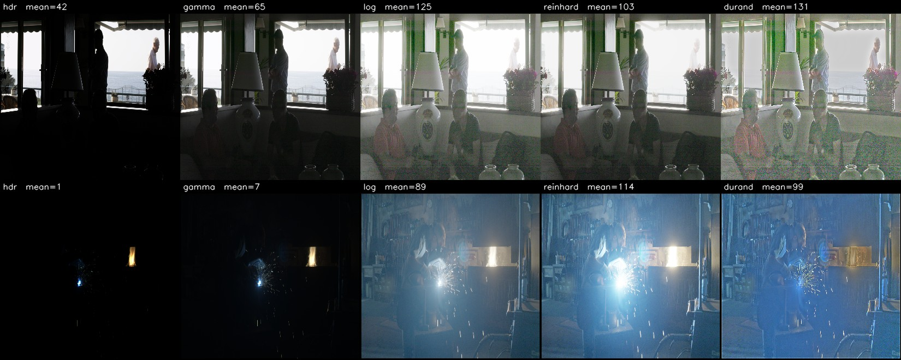

# HDR object detection on HDR4RTT

Object detection on high dynamic range imagery, using the HDR4RTT dataset: 4,080
OpenEXR images, 32,964 boxes, 20 Pascal VOC classes.

Three parts: an audit of the dataset, a rebuilt pipeline for running
[RAOD](https://openaccess.thecvf.com/content/CVPR2023/papers/Xu_Toward_RAW_Object_Detection_A_New_Benchmark_and_a_New_CVPR_2023_paper.pdf)
(CVPR 2023) on it, and a comparison of six tone mapping methods behind one fixed
detector.

[Repository structure](STRUCTURE.md) ·
[Progress note](hdr4rtt_rod/progress_note.html) ·
[Dataset audit](hdr4rtt_analysis/REPORT.md) ·
[Pipeline details](hdr4rtt_rod/README.md)

> **Work in progress, not peer reviewed.** Internship project, numbers are
> preliminary. Please ask before citing. No warranty, see [LICENSE](LICENSE).

---

## Which tone map works best?

HDR data has to be compressed before a detector can read it. This keeps the
detector fixed and changes only that step, so any difference comes from the tone
map alone.

Every row: RetinaNet R50-FPN v2, COCO-pretrained with a fresh 20-class head,
fine-tuned 10 epochs at batch 4. None is zero-shot. Deduplicated split, 2,506
train and 633 test, 20 classes.



The left column has no tone curve, and in the workshop scene the welding arc
takes the whole output range, leaving everything else black. The four to its
right are the same data under different curves.

| # | front end | whose method | mAP | AP50 | AP50 head-8 | S2 only |
|---|---|---|---|---|---|---|
| 1 | Reinhard *(global)* | classical, 2002 | **31.3** | 49.7 | **59.9** | 24.2 |
| 2 | HDR with gamma | standard display curve | 30.4 | 48.5 | 56.7 | 22.9 |
| 3 | Log compression | simple formula | 29.9 | 48.8 | 58.4 | 22.5 |
| 4 | Durand *(local)* | classical, 2002 | 29.7 | **50.6** | 58.1 | 22.7 |
| 5 | RAOD module | learned, CVPR 2023 | 28.7 | 46.5 | 54.1 | 22.0 |
| 6 | no tone curve | control | 24.4 | 41.8 | 49.3 | 18.8 |

Row 5 trains the learned module jointly with the detector, the way RAOD intends.
"head-8" averages only the eight classes with enough test instances to be stable.
"S2 only" scores the bracketed photographs alone, the one source where duplicates
are impossible.

> **Every figure on this page is mAP × 100**, the convention the papers use.
> `pycocotools` writes the same value between 0 and 1, so **31.3** here is
> `0.31286...` in the saved JSON. Two more conventions matter before comparing
> anything to a paper: mAP averages only over classes that have ground truth,
> and tables with different class counts do not compare with each other. See
> [reading the numbers](#reading-the-numbers).

**Skipping the tone curve costs 6.9 mAP** and is worst on every source. Kocdemir
found the same under both his detectors, where raw HDR scored 26.3 and 23.5.

**The choice of curve matters much less than making one.** The four sensible
operators sit within 1.6 points of each other, against a 6.9 point gap to using
nothing.

**RAOD's learned module finished fifth of six here**, 2.6 behind a one-line
formula from 2002. I suspected my own settings, so I retrained it three more times
changing one thing each: full learning rate, random init instead of RAOD's
weights, and input rescaled to the level those weights expect. Those retests ran
before deduplication, on the earlier full split. None reached Reinhard, gamma or
Durand there. The full-learning-rate run edged log compression by 0.2 (36.1
against 35.9), too small to read anything into, and the other two stayed below
every fixed operator.

A bigger detector narrows that gap only slightly. Behind Faster R-CNN, with
identical settings, the module still trails Reinhard by 2.3, 42.6 against 44.9 —
see [what the module does behind a larger
detector](#what-the-module-does-behind-a-larger-detector). An earlier version of
this page said the two drew level there; that rested on a mislabelled comparison
run. What a bigger detector does fix is RAOD's overall score: most of its deficit
against ordinary detectors is detector size, not tone mapping. In Kocdemir's
tables the verdict on his learned method flips between detectors; here RAOD's
module loses behind both.

---

## Detector comparison

A different question: how do the detectors compare? Both the input and the
detector change here, so this can't separate the two. Same deduplicated split,
but 2 classes rather than 20, so it doesn't compare with the table above either.

576 test images, 3,785 boxes, person and car only.

| detector | input | params | training | mAP | AP50 | Pedestrian | Car |
|---|---|---|---|---|---|---|---|
| RAOD (YOLOX-nano + its module) | HDR | 1M | zero-shot | 7.0 | 15.3 | 1.8 | 28.8 |
| RAOD (YOLOX-nano + its module) | HDR | 1M | fine-tuned | 27.0 | 55.0 | 49.7 | 60.2 |
| RetinaNet R50-FPN v2 | tone-mapped | 38M | zero-shot | 24.2 | 50.7 | 38.5 | 62.9 |
| Faster R-CNN R50-FPN v2 | tone-mapped | 44M | zero-shot | 26.4 | 54.7 | 44.6 | 64.8 |
| Faster R-CNN R50-FPN v2 | tone-mapped | 44M | fine-tuned | **43.0** | **74.0** | 68.8 | 79.1 |

"Tone-mapped" here means gamma at the 99th percentile, not Reinhard. The operator
was chosen before the tone-map comparison above existed: `pick_tmo.py` scored
eight candidates zero-shot and gamma won. RAOD fine-tuned for 50 epochs at batch
4; the fine-tuned Faster R-CNN for 12 epochs at batch 2, with
`train_torchvision.py`.

Ordinary tone-map-then-detect wins by a wide margin: 59% higher mAP in a tenth of
the training time, and an untrained off-the-shelf detector comes close to a
fine-tuned RAOD.

The comparison isn't capacity matched, though, and that accounts for nearly all of
it: holding the front end and the input fixed and changing only the detector
recovers 15.6 of those 16 points, measured in the next section. What remains
confounded is pretraining, since the large detector is COCO-pretrained on ordinary
photographs containing person and car specifically, while RAOD was pretrained on
five traffic classes from a car-mounted sensor. Neither advantage has anything to
do with HDR.

---

## What the module does behind a larger detector

The table above changes two things at once, so it cannot say which mattered.
This changes one. RAOD's own `Adaptive_Module`, initialised from their
`best-day_night` checkpoint, stays in front; the input stays linear HDR; only the
detector behind it changes. Same 2-class deduplicated split, 2,307 train and 576
test.

| detector | params | front end | training | mAP | AP50 | small | med | large |
|---|---|---|---|---|---|---|---|---|
| YOLOX-Nano *(RAOD's own)* | 1M | RAOD module | 50 ep, batch 4 | 27.0 | 55.0 | 3.8 | 12.8 | 41.6 |
| RetinaNet R50-FPN v2 | 38M | RAOD module | 10 ep, batch 4 | 36.9 | 64.1 | 5.5 | 18.9 | 54.7 |
| Faster R-CNN R50-FPN v2 | 44M | RAOD module | 10 ep, batch 4 | **42.6** | 72.6 | 10.1 | 28.1 | 57.7 |
| RetinaNet R50-FPN v2 | 38M | Reinhard | 10 ep, batch 4 | 39.8 | 68.3 | 7.7 | 22.3 | 57.0 |
| Faster R-CNN R50-FPN v2 | 44M | Reinhard | 10 ep, batch 4 | **44.9** | 76.2 | 11.7 | 31.1 | 59.5 |

Every row except RAOD's own comes from the same script, `train_frontend.py`, with
identical settings, so they compare directly. RAOD's row uses its own trainer and
schedule. The Faster R-CNN Reinhard row is the first of three identical runs,
which average 44.8; see [local tone maps](#local-tone-maps-two-tries-both-slightly-worse).

> **Correction, 14 and 17 October 2026.** An earlier version of this table had a
> Faster R-CNN row labelled Reinhard at 43.0 and said every row trained 10
> epochs. That row was really the gamma-p99 run from the detector table, trained
> 12 epochs at batch 2 by `train_torchvision.py`, and RAOD's own row trained 50
> epochs. On that basis the page said the module "draws level" with a tone map
> behind Faster R-CNN. The proper Reinhard + Faster R-CNN run, added 17 October
> with the same settings as the other rows, scores 44.9. The module trails it by
> 2.3, and the tie is withdrawn.

**Changing the detector is worth +15.6 mAP with the module untouched.** That is
most of the 18-point gap between RAOD and a tone-mapped Faster R-CNN (27.0 against
44.9). The remaining 2.3 is the front end: behind the same Faster R-CNN, on
identical settings, Reinhard still beats the module, 44.9 against 42.6. The gap in
the detector table was mostly capacity, then, but not all of it.

Two separate effects, both real. 1M to 38M is +9.9, which is size. 38M to 44M is
+5.7 on only 6M more parameters, so that step is one-stage to two-stage rather
than size — Faster R-CNN's proposal stage is doing the work.

**The front-end gap does not close with a bigger detector.** Like for like, the
module trails Reinhard by 2.6 on the 20-class split with RetinaNet, 2.9 here with
RetinaNet, and 2.3 with Faster R-CNN. A stronger detector narrows it a little; it
does not remove it.

Three caveats. **Noise is measured for one cell only.** Reinhard behind Faster
R-CNN, retrained three times with nothing changed, scored 44.93, 44.85 and 44.75,
a spread of 0.18. The module's gap in that row, 2.2 against the three-run average,
is more than ten times that. The other cells are still single runs, though three
separate like-for-like gaps landing between 2.3 and 2.9 is some evidence on its
own. **Pretraining is still confounded**, since COCO contains person and
car specifically while RAOD pretrained on five traffic classes from a car-mounted
sensor. And the module is **not free**. Behind RetinaNet it took 11.3 GB and 55
minutes to train, against 3.3 GB and 15 minutes with Reinhard; behind Faster
R-CNN, 11.0 GB and 58 minutes against 3.0 GB and 19 minutes (training time only,
from `capacity.log`, `capacity2.log` and `capacity3.log`). The module processes
the full 1280×1280 float image before the detector downsizes it to 800, while a
fixed tone map is computed once, offline. So it costs three to four times the
training time and memory, and still scores lower.

Reproduce with [`run_capacity.sh`](hdr4rtt_rod/run_capacity.sh),
[`run_capacity2.sh`](hdr4rtt_rod/run_capacity2.sh) and
[`run_capacity3.sh`](hdr4rtt_rod/run_capacity3.sh), and the two repeat runs with
[`run_localexp_and_noise.sh`](hdr4rtt_rod/run_localexp_and_noise.sh); numbers in
`results/capacity/`.

---

## Reading the numbers

Everything is mAP × 100, the convention the papers use. `pycocotools` prints the
same values between 0 and 1, so 31.3 here is 0.313 in the JSON under `results/`.

**The two tables above don't compare with each other.** 20 classes against 2. A
2-class average runs far higher for the same detector.

**mAP averages over classes that have ground truth, not classes declared.** The
20-class tables therefore average over 18, since `cat` and `cow` have no test
instances, and the 2-class table averages over 2 of 5 declared. That second one
isn't a choice: RAOD's released head has five fixed outputs and only `person` and
`car` map onto it honestly.

Rare classes are a real problem. The test set has 2 `bus`, 2 `motorbike`, 5
`train`, 6 `horse`. A class with two examples scores close to random but carries
the same weight as `person` with 3,719. That's what the head-8 column is for.

**Run-to-run noise has been measured once.** Reinhard + Faster R-CNN on the
2-class split, trained three times with nothing changed: 44.93, 44.85, 44.75.
Treat a gap under about 0.3 between two single runs as noise. The size columns
swing more, by about 1 point each, and other detectors or the learned module may
too; they haven't been repeated.

**Reinhard here is the global variant**, one curve applied uniformly. Kocdemir
lists global and local separately elsewhere (CityScapes: 32.7 and 33.2) but his
HDR4RTT table says only "Reinhard 29.6", so his row and mine may not be the same
operator. Durand is local in both. Local Reinhard has since been tested here, in
a different setting; see [local tone maps](#local-tone-maps-two-tries-both-slightly-worse).

---

## Deduplication

One group of images, S1, is mostly near-duplicates: 1,289 files that reduce to
367 distinct scenes. Before removing them the best arm scored 90.1 mAP on S1
alone, at 99.2 AP50, which nothing generalises to.

I used Ulaş's `dedupe_hdr_frames.py`, which compares each frame by SSIM against
the last one it kept, at threshold 0.92. That keeps 3,145 of 4,080 images: 28% of
S1, 100% of S2, 99% of S3. I chose the threshold by what it removes rather than
by chasing a count. Harsher settings get closer to Kocdemir's 1,871 images but
only by deleting S2 photographs taken on separate days, which have no duplicates
to remove.

**This is not Kocdemir's split.** His list wasn't available, so this is my own
deduplication and the count differs.

Every arm dropped 5.9 to 7.0 mAP afterwards and the ranking held. Two things
confirm the drop came from duplicates rather than something else. S2 barely moved
(24.7 to 24.2), having lost almost nothing to deduplication. And in the detector
table the fine-tuned rows fell 8 to 9 points while the zero-shot rows fell less:
4.6 and 5.4 for the torchvision detectors, and RAOD's rose 1.1. A model that never
trained on this data can't benefit from duplicates, so its drop most likely comes
from the test set losing easy S1 images. Comparing Faster R-CNN with itself, the
fine-tuned model lost about 4 points more than the zero-shot one (8.7 against
4.6), roughly what the duplicates had been adding.

Note S3 survives at 99%, so its frames genuinely differ. My earlier focus on S3,
the only source with readable frame numbers, was aimed at the wrong place.

---

## The dataset

I decoded and measured all 4,080 EXR files. Full detail in
[REPORT.md](hdr4rtt_analysis/REPORT.md); the points that changed decisions here:

- Three sources glued together, and the EXR headers separate them for free: 1,289
  video frames, 1,489 bracketed photographs, 1,302 frames of one HDR video.
- Neither value ceiling is over-exposure. About one pixel per image reaches it,
  because each image was individually normalised, so the stored values carry no
  absolute brightness meaning.
- 41% of images contain negative pixel values, down to −872. Clamp before any log
  or gamma step.
- 303 images (7.4%) are a separate very dark cluster, roughly 250× darker than
  the rest, holding 13.1% of all boxes.
- Median dynamic range 4.11 decades, about 13.7 stops. Maximum 7.83.
- The shipped train/test split leaks. Every test frame in the video source has a
  training frame within ±3, worth +2.0 mAP in a controlled two-model experiment.

Per-image statistics for all 4,080 files are in
[`hdr_stats_sources.csv`](hdr4rtt_analysis/hdr_stats_sources.csv).

---

## Two bugs in the earlier pipeline

**Wrong input scale in evaluation.** RAOD's loader divides by 255 inside
`load_image`, so the network expects 0 to 1. The evaluation script skipped that
and fed 0 to 255. RAOD's tone-mapping module raises its input to the power
1/gamma with gamma between 7 and 10.5, so everything saturated and the frame went
white. The trap is that the same division sits commented out in
`ValTransformRaw`, the obvious place to look, because it already happened one
level up. RAOD's own sample image gave 0 detections; after restoring one line it
gave 5.

**The converter aimed at the opposite of what the model wants.** RAOD tone-maps
internally and expects dark, linear input averaging around 0.012. The previous
converter stretched images to fill 0 to 255, averaging 0.377, 32× brighter than
anything it trained on. Every rescaling variant tried shares the same "use the
full range" goal, so they all fail the same way.

---

## Comparison with the MS thesis

From İ. H. Kocdemir's MS thesis and the corresponding Pattern Recognition Letters
172 (2023) 230–236 paper, on the dataset the thesis calls OOD: 20 Pascal VOC
classes, near-identical frames removed, 1,491 train and 380 test, 1024×576.

Everything below is quoted from his thesis. I did not re-run any of it. All his
rows are fine-tuned, and ✓ under "joint" marks where his generator trains
alongside the detector.

**RetinaNet** (Table 4.2) · **Faster R-CNN** (Table 4.3)

| front end | joint | RetinaNet mAP | Faster R-CNN mAP |
|---|---|---|---|
| HDR (raw, no normalisation) | | **26.3** | **23.5** |
| LDR | | 28.2 | 24.7 |
| Reinhard | | 29.6 | 28.1 |
| HDR with gamma | | 29.8 | 27.7 |
| Fattal | | 29.8 | **29.5** |
| Best TMO per picture | | 30.0 | 29.3 |
| TMO-GAN | ✗ | 30.0 | 28.6 |
| Ashikhmin | | 30.1 | 28.9 |
| Durand | | 30.6 | 28.8 |
| Std. LDR | | 31.0 | 28.3 |
| Mantiuk | | 31.3 | 29.1 |
| **TMO-GAN (OOD)** | ✓ | **31.6** | 27.7 |

His two tables are merged here into one. Three TMO-GAN ablation rows that
differ between them are omitted for space: COCO-pretrained variants scoring 30.2
under RetinaNet, and 26.3 and 27.3 under Faster R-CNN. See the thesis for those.

Two things stand out. **Raw HDR is worst in both**, below plain LDR, so
normalisation rather than bit depth is what the detector needs. And **the
detector changes the conclusion**: his learned method beats every classical
operator under RetinaNet, 31.6 against 31.3, but loses to four of them under
Faster R-CNN, 27.7 against 29.5. Same method, same data, opposite answer.

Thesis Table 3.1 runs the same comparison on CityScapes, where HDR with gamma
(33.3) barely separates from Std. LDR (33.1), and the thesis says plainly that no
advantage for HDR showed up there.

### Status of the two review questions

**Include the thesis results here.** Done, above.

**Compare the 2023 paper and the thesis method fairly, given they used different
detectors.** Partly. The detector is now held fixed and RAOD's module measured
under that control at 28.7 mAP. TMO-GAN has not been measured the same way yet,
so what follows is an indirect comparison rather than a head-to-head.

### Comparing the two learned methods

The two learned methods have never been measured side by side. I had understood
TMO-GAN's software to be lost, and an earlier version of this page said so. Its
training code is in fact public: the thesis author's repository,
[ismailkocdemir/tmo_detector](https://github.com/ismailkocdemir/tmo_detector),
holds a GAN tone mapper trained jointly with a detector. It ships no trained
weights, it is built on mmdetection 2.x, and I have not yet confirmed it is the
exact code behind the published tables. Until it runs here, the comparison stays
indirect.

I tried using the operators common to both experiments to map one scale onto the
other. It fails: the rankings invert. Reinhard is his weakest tone map and my
strongest, Durand his strongest of the three and my weakest. An inversion isn't
an offset, so no scale factor reconciles them. Recording it as a negative result.
Part of the Reinhard gap may be global against local rather than real
disagreement. Local Reinhard has since run here and scored 0.5 below global (see
[local tone maps](#local-tone-maps-two-tries-both-slightly-worse)), which leans
that way. It doesn't settle it: that test was behind Faster R-CNN on 2 classes,
and the inversion is in the 20-class RetinaNet table.

What does work is comparing each method against the best classical operator in
its own experiment, which cancels the differences in split and detector version.
His method edged 0.3 past its best classical operator; RAOD's module fell 2.6
behind mine. About 2.9 apart in his favour, measured against a shared reference
rather than on a shared scale.

That reference depends on the detector. RAOD's 2.6 deficit is a RetinaNet figure;
behind Faster R-CNN, like for like, the capacity runs put it at 2.3. Doing the
same arithmetic with his Faster R-CNN table, where TMO-GAN sat 1.8 behind Fattal
(27.7 against 29.5), leaves his method about 0.5 ahead. So the direction holds
under both detectors, in his favour, while the size ranges from 0.5 to 2.9.
Earlier versions of this paragraph gave 0.7, then 1.4 in RAOD's favour; both
rested on the mislabelled Faster R-CNN run. Treat the direction as informative and
the size as not, until TMO-GAN runs behind a fixed detector too.

Deduplication helped here. My best operator now scores 31.3 against his best
classical 31.3, where before I sat about 7 points above him with no explanation I
could defend. Both are RetinaNet but not the same implementation, and the splits
and class counts still differ, so this is convergence rather than a head-to-head.

To close it properly, train TMO-GAN from that repository, or re-implement it if
that fails, and run it as a seventh front end.

---

## Where the detector fails

I classified every prediction and every missed box, then joined each box to
statistics measured from the original EXR. Details in
[`analyze_failures.py`](hdr4rtt_rod/analyze_failures.py) and the CSV under
`results/failures/`.

Of predictions above 0.3 confidence: 58.8% correct, **18.8% find the object but
draw a poor box**, 15.2% land on background, 4.6% wrong class, 2.6% duplicate.
38% of ground-truth boxes are missed entirely. The poor-box category is the
largest single fixable one.

Holding object size fixed, **misses track local contrast rather than darkness**:

| dynamic range inside the object's own box | missed (objects 5–10% of image side) |
|---|---|
| under 1 decade | **66%** |
| over 3 decades | **12%** |

Flat scenes are harder than high-contrast ones, and objects at the same
brightness as their surroundings are missed more often than objects that are much
darker or much brighter. The worst image in the set is a warehouse of 254
near-identical dark bottles, none found, at a median object size of 6.2% of the
image side, so size doesn't explain that one.

Every operator here compresses global range. None targets contrast at the scale
objects actually occupy.

---

## Local tone maps: two tries, both slightly worse

The failure analysis says misses follow contrast inside the object's own box, so
the obvious next step is a tone map that works locally. I tried two, each a small
change to global Reinhard, behind the same Faster R-CNN with the capacity table's
settings: 2-class deduplicated split, 10 epochs, batch 4. Global Reinhard was
retrained twice more alongside, so this table has a measured noise level.

| front end | runs | mAP | AP50 | small | med | large |
|---|---|---|---|---|---|---|
| Reinhard *(global)* | 3 | **44.8** (44.75–44.93) | 76.1 | 12.2 | 30.6 | 59.5 |
| Reinhard *(local)* | 1 | 44.3 | 76.3 | 11.2 | 30.6 | 59.0 |
| Local exposure, then Reinhard | 1 | 44.0 | 75.0 | 10.8 | 29.2 | 59.2 |
| RAOD module | 1 | 42.6 | 72.6 | 10.1 | 28.1 | 57.7 |

The global row averages its three runs.

**The noise is small.** The three global runs span 0.18 mAP, and both local
variants land below the lowest of them, so both losses are real, if small. The
size columns swing more between identical runs (small 11.7 to 12.8, medium 30.0
to 31.1), so read those loosely.

**Local Reinhard** is the dodging-and-burning operator from the same 2002 paper:
each pixel is divided by a blurred neighbourhood instead of by itself. In dark
areas the "1" in L/(1 + V) outweighs any neighbourhood value, so dark objects come
out exactly as under the global curve. Only bright areas change, and on six sample
images the average pixel moved by just 1 to 5 levels out of 255. It cost 0.5.

**Local exposure** goes after the dark areas directly. Each region is exposed from
its own average brightness, pulled half-way from the whole frame's and capped at
two stops either way, with region edges taken from Durand's edge-aware base layer.
On eight sample images it lifted the darkest third of pixels by 19 levels and
lowered the brightest third by 28, and the shadows look clearly better. It cost
0.9, spread across small and medium objects and cars. Both of its settings were
fixed before training, not tuned on the test split.

**Making the picture look better locally did not help the detector.** A likely
reason, not yet tested: lifting a dark car and darkening the bright road around
it also brings the two closer together, and a COCO-pretrained detector leans on
that contrast. Two hand-set operators don't rule out a learned one, but a learned
local tone map should start exactly at global Reinhard, so it only moves away
from it where that helps.

Reproduce with [`run_local_reinhard.sh`](hdr4rtt_rod/run_local_reinhard.sh) and
[`run_localexp_and_noise.sh`](hdr4rtt_rod/run_localexp_and_noise.sh); the arms
are `reinhard_local` and `reinhard_localexp` in
[`make_frontends.py`](hdr4rtt_rod/make_frontends.py), and the numbers are in
`results/capacity/`.

---

## Input geometry: three attempts, one small gain

The failure analysis blames poor boxes and misses, which points at the input
resolution and the anchor boxes. I tried all three geometric knobs. Only the
first helped.

Baseline throughout: Reinhard, RetinaNet R50-FPN v2, fine-tuned 10 epochs at
batch 4 on the deduplicated split.

| change | anchor fit | mAP | AP50 | AP75 | small | med | large | AR100 |
|---|---|---|---|---|---|---|---|---|
| none, images reach the net at 800px | 75.3% | 31.3 | 49.7 | 31.4 | 6.2 | 18.3 | **42.9** | 44.5 |
| **short side raised to 1280** | 82.9% | **31.7** | **53.4** | **31.5** | 8.9 | 23.4 | 41.7 | 44.3 |
| 1280, anchor ratios 1, 2.5, 5 | 94.6% | 30.1 | 49.3 | 30.7 | 9.0 | 23.1 | 40.0 | 44.5 |
| 1280, anchor ratios 0.5, 1.6, 6.4 | 96.0% | 30.4 | 50.5 | 29.6 | **11.0** | 22.7 | 40.2 | **46.9** |
| native aspect ratio, long side 2048 | — | 31.4 | 51.6 | 30.7 | 10.1 | **23.9** | 37.0 | 44.8 |

**The first row was hiding a defect.** torchvision rescales its input so the short
side equals `min_size`, 800 by default, and nothing in the pipeline mentioned it.
Every 1280×1280 image had been arriving at the network as 800×800. Raising that
limit is the only change here that gained anything: +0.4 mAP, +3.7 AP50, and
small-object AP from 6.2 to 8.9. It is now `--min_size` on both scripts, stored in
the checkpoint so evaluation cannot silently disagree with training.

### The anchors fit badly, and fixing that made things worse

RetinaNet matches an object to a template box, an anchor, when the two overlap by
IoU 0.5. An object no anchor reaches cannot become a positive example, so it is
close to unlearnable. [`anchor_fit.py`](hdr4rtt_rod/anchor_fit.py) measures that
share before any training, which costs seconds rather than a GPU-hour.

It turns up a genuine mismatch. **85% of the objects here are taller than wide,
median height/width 2.39 and upper quartile 3.53, while torchvision's stock ratios
stop at 2.0.** Those defaults were fitted for COCO, not for people and bottles.
Retuning them lifts the matchable share from 82.9% to 96.0%.

The detector got worse anyway: 31.7 to 30.4 mAP.

What the retuned anchors do is find more and localise worse. Recall rises from
44.3 to 46.9, small-object AP from 8.9 to 11.0, while AP75, which demands tight
boxes, falls from 31.5 to 29.6. mAP averages overlap thresholds from 0.5 to 0.95,
so the sloppier boxes outweigh the extra finds.

The likely cause is structural. Only the classification head is rebuilt for 20
classes; the box regression head is inherited from COCO pretraining, where it
learned offsets tied to the default anchor shapes. New shapes invalidate those
priors, and 10 epochs on 2,506 images will not retrain them. Adding a fourth,
taller ratio would test this properly, but the anchor count fixes the regression
head's output width, so that means rebuilding it too. Untested.

One measurement worth keeping: scaling the anchor *sizes* to match the higher
resolution, the textbook move for preserving relative coverage, drops small-object
matching to **0.0%**. The smallest anchor moves from 32px to 51px and nothing
under 32² in area can reach IoU 0.5 against it. That configuration was abandoned
two epochs in rather than trained to completion.

### What this says

Resolution, aspect ratio and anchors all land within 1.3 mAP of each other, and
the headline barely moved. **Input geometry is not what limits this model.** That
agrees with the failure analysis, which pointed at local contrast rather than
anything geometric.

Two caveats against reading this as a dead end. The small-object and recall gains
are real, so the retuned-ratio model is the better choice if small objects matter
more than tight boxes. And the anchor-fit share is a ceiling, not a score: it says
what is reachable, never what gets learned. I predicted mAP from it and was wrong.

---

## Reproducing

You need PyTorch and OpenCV. RAOD's own repository supplies the model code. Data
paths sit at the top of each script.

```bash
python hdr4rtt_analysis/scripts/scan_hdr.py
```

```bash
python hdr4rtt_rod/build_deduped_split.py
```

```bash
python hdr4rtt_rod/make_frontends.py
```

```bash
python hdr4rtt_rod/train_frontend.py --arm reinhard --arch retinanet --epochs 10 --batch 4
```

```bash
python hdr4rtt_rod/eval_frontend.py --arm reinhard --arch retinanet --batch 4
```

**Pass `--min_size 1280 --max_size 2133` to train at full resolution.** Left at the
defaults, torchvision shrinks every 1280x1280 image to 800x800 before the backbone
sees it, silently. Evaluation reads the value back from the checkpoint, so the two
cannot drift apart. `--anchor_ratios` and `--anchor_scale` retune the anchors; both
are recorded the same way, and both lost to the defaults.

```bash
python hdr4rtt_rod/anchor_fit.py --search
```

**Use batch size 4 on a 16 GB GPU, not 8.** Batch 8 needs 17.51 GB on a 17.1 GB
card, and Windows won't raise an out-of-memory error for that. It pages GPU
memory to system RAM, so the run just gets about 8× slower with nothing in the
log to explain it. My batch-8 run reported an 8-day ETA.

One more method note: a weak tone map would have rigged the comparison before
training started, so I scored eight candidates with a COCO-pretrained detector
first. The spread was 10% relative, enough to have decided the outcome on its
own. `pick_tmo.py` reproduces that sweep.

---

## Layout

| path | contents |
|---|---|
| `hdr4rtt_analysis/` | dataset audit: scripts, report, per-image statistics |
| `hdr4rtt_rod/` | conversion, annotations, splits, configs, evaluation |
| `hdr4rtt_rod/results/` | every reported number, as saved JSON |
| `hdr4rtt_rod/viz/` | ground truth and predictions drawn on converted images |
| `hdr4rtt_rod/anchor_fit.py` | anchor coverage against the real box shapes, before training |
| `hdr4rtt_rod/progress_note.html` | step-by-step record of the work |

Checkpoints, converted imagery and the dataset itself are excluded on purpose,
see [.gitignore](.gitignore).

**Open questions**

1. Isolate pretraining, the one confound the capacity runs left standing: COCO
   contains person and car specifically, RAOD's five traffic classes do not.
2. Run TMO-GAN as a seventh front end, from the author's public code if it still
   trains, so the two learned methods can be compared directly.
3. Run local Reinhard on the 20-class RetinaNet table, to find out whether the
   ranking inversion against the thesis is real or just two different operators.
   It has only run behind Faster R-CNN on 2 classes so far, 0.5 below global.
4. Target local contrast at object scale rather than global range, which is what
   the failure analysis points at. Two fixed local tone maps both lost slightly;
   a learned one that starts at global Reinhard is still untested.
5. Repeat the other capacity cells, as was done for Reinhard + Faster R-CNN, so
   every gap in that table has a measured noise level.
6. Rebuild the box regression head alongside the classification head, so anchor
   ratios can be retuned without discarding COCO's regression priors. That is the
   test the anchor result needs and did not get.

---

## Licence and attribution

Code © 2026 Sana Niroomand and the OGAM Research Laboratory, Middle East
Technical University (METU), under the [MIT licence](LICENSE). Research code,
provided as is, not meant for production use.

Full attribution in [NOTICE](NOTICE). In short:

| what | relationship | terms |
|---|---|---|
| **RAOD** (Xu et al., CVPR 2023) | two config files are modified derivatives; other files call it at runtime | © Huawei + Megvii, Apache 2.0, see [LICENSE-Apache-2.0.txt](LICENSE-Apache-2.0.txt) |
| RAOD model weights | not redistributed | original terms |
| **TMO-Det** (Kocdemir et al.) | no code used, results quoted only | © authors and publisher |
| Reinhard, Durand operators | algorithms re-implemented from the papers | methods credited to their authors |
| torchvision, OpenCV, pycocotools | called as libraries | BSD / Apache 2.0 |
| HDR4RTT / OOD dataset | not redistributed in any form | obtain from its creators |

The two derivative files, `cfg_hdr4rtt_rod.py` and `cfg_hdr4rtt_rod_original.py`,
stay under Apache 2.0 with headers listing what I changed. Everything else is
original work under MIT.

The tone-mapping operators here are simplified re-implementations that I tuned
against this dataset. Don't treat them as reference implementations. Any weakness
in them is mine, not the original authors'.

Please cite the original work rather than this repository:

> R. Xu, C. Chen, J. Peng, C. Li, Y. Huang, F. Song, Y. Yan, Z. Xiong.
> *Toward RAW Object Detection: A New Benchmark and a New Model.* CVPR 2023.

> İ. H. Kocdemir, A. Koz, A. O. Akyuz, et al.
> *TMO-Det: Deep tone-mapping optimized with and for object detection.*
> Pattern Recognition Letters 172 (2023) 230–236.

Thesis tables appear here for academic comparison with attribution. They're
quoted, not reproduced experimentally: no trained TMO-GAN models are available,
and its public training code has not been run here.

Any errors here are mine, not the original authors'.
